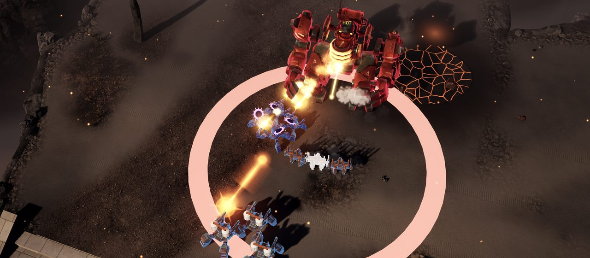
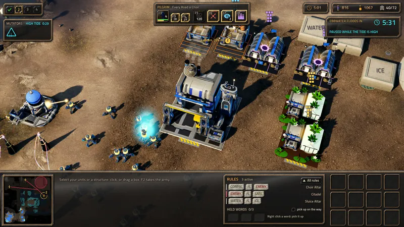
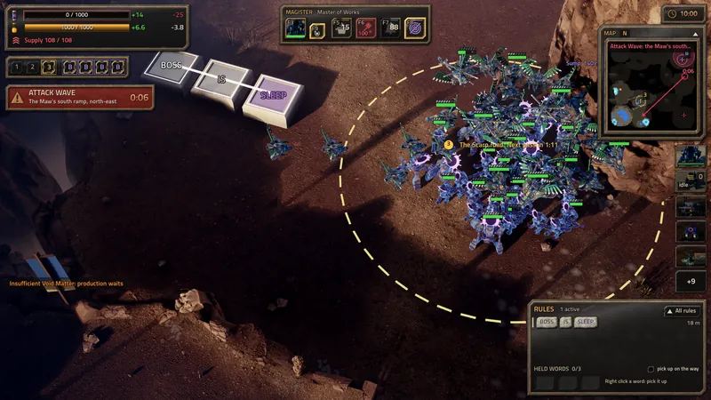
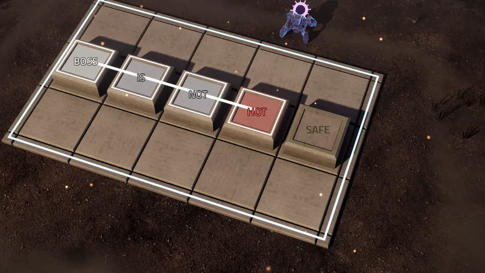
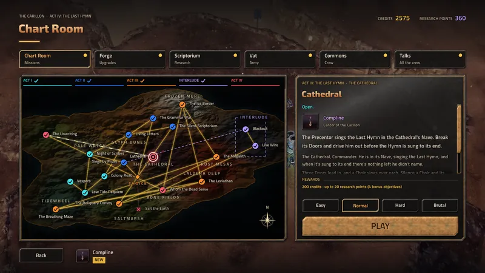

# CHIMERA

**Stitch an army together from parts, outlast everything the Corruption throws at you, then rewrite the laws of the world that is trying to end you.**

CHIMERA is a real-time strategy game for Windows, made by one developer. Build a base, gather Void Matter and Optical Fluid, raise an army, and fight through a 20-mission campaign where the rules of the battlefield are sentences made of stone words that you push into place.

**[Website](https://duke4e.github.io/chimera-game/)** · **[Download the latest build](https://github.com/duke4e/chimera-game/releases/latest)** · **[Report a bug or share an idea](https://github.com/duke4e/chimera-game/issues)**

> **Early preview.** The whole campaign can be played from start to finish, but balance is still being tuned and missions, effects and screens are still being polished. Feedback from this build decides what gets worked on next.

## What's in it

- **Three ways to build.** Castellan builds from a Construction Yard and its sidebar; Pilgrim's Workers raise structures on the spot and Warp units In; Magister's Engineers run streaming production with Tech 1, 2 and 3 factories and a strategic zoom out to the whole map.
- **The Chimera you assemble.** Pick a Commander, one of three kinds of Chimera (Shellsong, Dynamo Grid, Ossuary) and three of eight production lines. At Tech 3 the Graft Vat fuses two units into a hybrid.
- **Rules made of words.** Take an Altar and push words into its grid: `WATER IS ICE` and the lake is a road, `ENEMY IS WEAK` and they break at the first hit. The Corruption writes rules too.
- **The Last Hymn.** A 20-mission campaign aboard the Carillon, a walking bell-tower fortress, with a Forge, research, Mercenaries and a crew to talk to between missions.
- **The Corruption.** Ten levels above Brutal, drawing from about thirty mutators, plus a Weekly Mutation.
- **More modes.** Operations (missions outside the story), Skirmish against the Corruption or an AI Chimera, the Academy's lessons and medal challenges, and 1v1 or co-op over the network.

  
  

  
  

More screenshots are on the [website](https://duke4e.github.io/chimera-game/#gallery).

## Download and run

1. Download the zip from the [latest release](https://github.com/duke4e/chimera-game/releases/latest) (about 1.2 GB).
2. Unzip the whole folder somewhere you can write to, such as `C:\Games\`, not Program Files. Keep that folder's path short (89 characters at most), because some files sit deep inside.
3. Run `CHIMERA.exe`. The build isn't signed, so Windows may warn about an unknown publisher: choose **More info**, then **Run anyway**.
4. The game opens full screen; Alt+Enter or Options switches to a window. Press F1 in a mission for the controls.

Nothing is installed. Settings, progress, saves and the log are kept in `%APPDATA%\CHIMERA`; delete that folder for a completely fresh start, or turn on **Options → Unlock everything** to try it all at once.

### Requirements

| | |
|---|---|
| System | Windows 10 or 11, 64-bit |
| Graphics | A graphics card with Vulkan support and an up-to-date driver |
| Disk | About 1.2 GB to download, 1.4 GB unpacked |

Minimum specs haven't been measured yet. Without Vulkan (very old integrated graphics, Remote Desktop) the game can't start; the reason is written to `%APPDATA%\CHIMERA\chimera.log`. Rarely the game closes the moment it starts: just start it again.

## Feedback

Bugs, crashes, missions that felt unfair, ideas: please [open an issue](https://github.com/duke4e/chimera-game/issues/new). Say what you were doing, which Commander and mission, and for a crash attach `%APPDATA%\CHIMERA\chimera.log`. If the game runs well (or badly) on your hardware, that's useful to hear too.

## About this repository

This repository holds the game's website (served by GitHub Pages from this branch) and its releases. The game's source code and art are not here.

CHIMERA © 2026 duke4e. **All rights reserved.** No licence to the game, its code, its art or this website is granted. Music, fonts, textures, models and sounds by other authors are used under their own licences and credited in the game's Credits screen.
